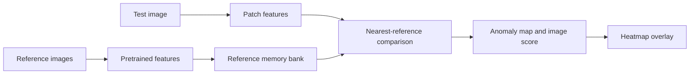

# Metal Part Anomaly Detection

[](https://github.com/muhammetsimssek/metal-part-anomaly-detection/actions/workflows/repository-checks.yml)

**Python · PyTorch · OpenCV · PatchCore · DINOv2**

A computer vision prototype developed for a factory's metal-part inspection need. It uses pretrained feature extractors and reference memory banks to highlight visual differences and produce anomaly-score heatmaps.

[Türkçe](README_TR.md) · [Setup](docs/SETUP.md) · [Methods and results](docs/METHODS.md) · [Presentation (TR)](docs/Fabrika_Portfoy_TR.pdf)


*Historical output: original image, Full Memory PatchCore and DINOv2 v4. This is a qualitative comparison, not a measured accuracy result.*

## What I built

- Compared WideResNet/PatchCore and DINOv2-based feature extraction for limited-data inspection.
- Built reference feature memory banks and compared new image regions with nearest reference features.
- Produced image-level anomaly scores and heatmap overlays.
- Investigated how surface marks, shape differences and inspection markings affect each approach.

My contribution is the anomaly-analysis implementation and experiments. A teammate's separate hole-diameter measurement work is outside this repository. The pretrained research models are credited below.

## Pipeline



| Approach | Feature extractor | Input / grid | Distance |
|---|---|---|---|
| Full Memory PatchCore | ImageNet WideResNet50-2 | 320×320 / 48×48 | Euclidean |
| DINOv2 v4 | ViT-B/14 with registers | 448×448 / 32×32 | 1 − cosine similarity |

DINOv2 uses five views, aligns their maps back to the original orientation and averages them. Both methods use the maximum of the smoothed, resized map as the image score. Pretrained backbones are not fine-tuned.

## Run

Follow [SETUP.md](docs/SETUP.md) to install dependencies and place your own photographs in `train_data/` and `test_data/`. From the repository root:

```bash
python run.py full-memory
python run.py dinov2
```

The launcher checks that input images are present before starting an experiment. Both original experiment scripts use CPU inference and download pretrained models on first use. Full reference memory can require substantial RAM. Dependencies are listed, but historical versions were not recorded and a fresh-environment full inference run has not been revalidated for publication.

## Results and scope

The compared local runs contain **22 reference images, 13 test images and 26 stored outputs**. These are counts from the selected runs, not the entire project dataset. The repository includes four selected visual comparisons and their explanation in [METHODS.md](docs/METHODS.md).

The project reached the demonstration stage. Additional photographs from the intended inspection environment were requested, but the data handoff did not continue. A calibrated acceptance/rejection threshold, labelled performance evaluation, speed benchmark and production deployment were not completed.

Scores are not defect probabilities. The two methods have different score scales; heatmap colors are normalized per image. A response to a marking or bend is not automatically a confirmed defect.

## Repository structure

```text
experiments/       Original Full Memory and DINOv2 experiment scripts
assets/            Selected stored comparison images
docs/              Setup, method notes and presentation
tools/             Repository validation without model downloads
.github/workflows/ Automated source-syntax and documentation checks
run.py             Input checks and experiment launcher
requirements.txt   Model and image-processing dependencies
```

The full factory dataset, inspection booklet, model weights and third-party Dinomaly source are excluded. The original local project was preserved.

## Research references

- [DINOv2 — Meta / FAIR](https://github.com/facebookresearch/dinov2)
- [TorchVision — WideResNet](https://github.com/pytorch/vision)
- [PatchCore research implementation](https://github.com/amazon-science/patchcore-inspection)

This repository contains application experiments using these models and ideas. Upstream code and pretrained weights are governed by their respective terms.
