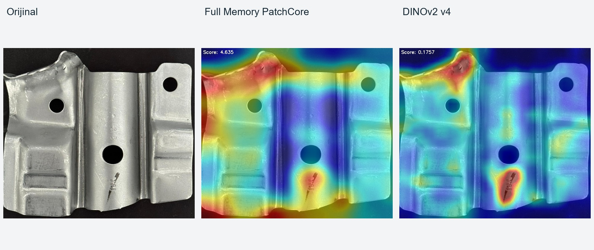
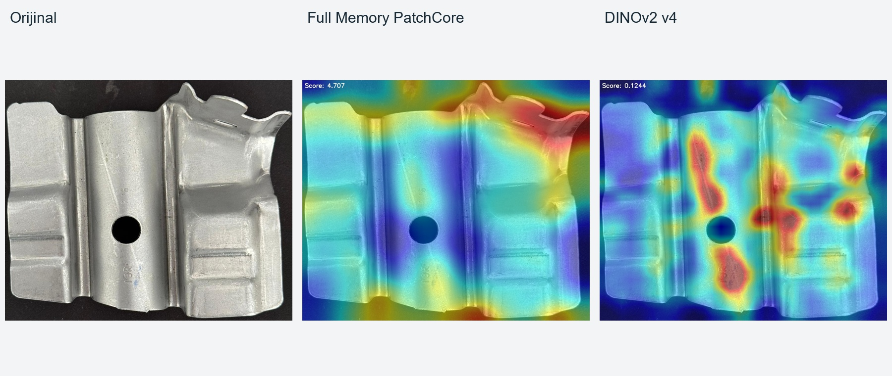
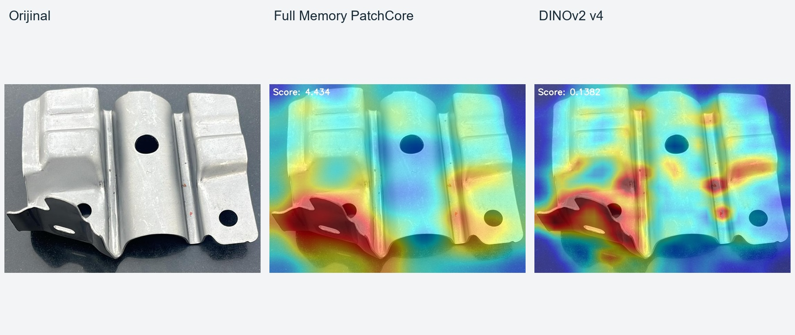
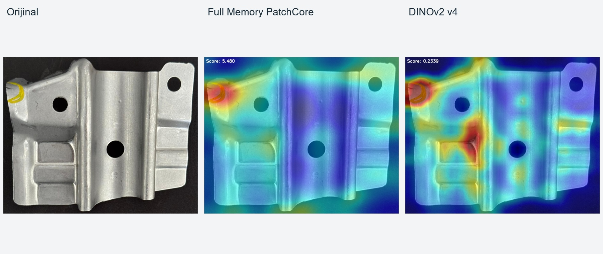

# Methods and qualitative results

[Overview](../README.md) · [Türkçe](../README_TR.md)

## Full Memory PatchCore

`experiments/patchcore_full_memory.py` extracts ImageNet-pretrained WideResNet50-2 layer 2 and layer 3 features, adaptively pools both to 48×48, concatenates them and stores all reference vectors. Query vectors are compared with the reference bank using Euclidean distance. The map is Gaussian-smoothed with an 11×11 kernel, resized to the original image size and reduced by its maximum for the image score.

There is no coreset sampling in this experiment. Comments mentioning 56 or 64 are historical; the numeric grid setting is 48. Full-memory comparisons can be slow and memory intensive.

## DINOv2 v4

`experiments/dinov2_patchcore_v4.py` uses `dinov2_vitb14_reg` at 448×448. Intermediate blocks 5, 8 and 11 are concatenated; patch vectors are normalized. `TOP_K=1` and `STD_WEIGHT=0` produce a nearest-reference 1 − cosine similarity score on a 32×32 grid.

Five views are applied to reference and query images: identity, horizontal flip and 90°/180°/270° rotation. Query maps are inverted to the original orientation and averaged. A 3×3 Gaussian blur and resize precede the maximum image score. Display contrast uses the 1st and 99th percentiles per image.

## Stored comparisons

### Surface and edge differences

Both methods highlight the upper-left irregular region and a dark mark near the lower center. DINOv2 produces a narrower response around the lower mark. The mark type and defect boundary were not independently confirmed.

### Different responses to shape

Full Memory responds more strongly around the upper-right irregular shape, while DINOv2 also responds to text and other surface regions. Since normal part variants may include bends and tabs, no definitive rejection label was assigned.

### Shared response

Both heatmaps highlight the lower-left bent area. Acceptance depends on the correct part variant and inspection criteria; agreement between methods is not an accuracy metric.

### Sensitivity to inspection marks

Both approaches respond to a yellow marking. Its inspection meaning is unclear, so the response is not labelled as a true positive or false alarm.

## Evaluation boundary

These are historical outputs inspected qualitatively. The repository does not report AUROC, F1, precision/recall, a calibrated rejection threshold or deployment performance. A representative labelled validation set, an independent test split and field capture conditions would be needed for a part-level acceptance/rejection evaluation.
